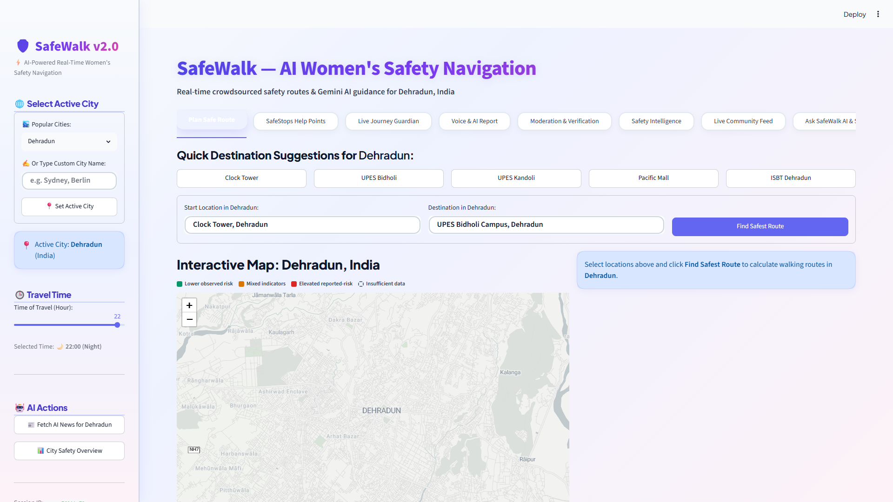
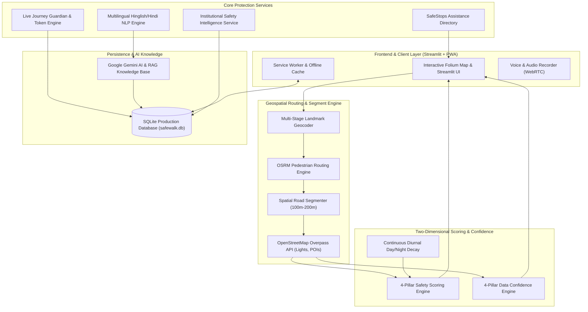
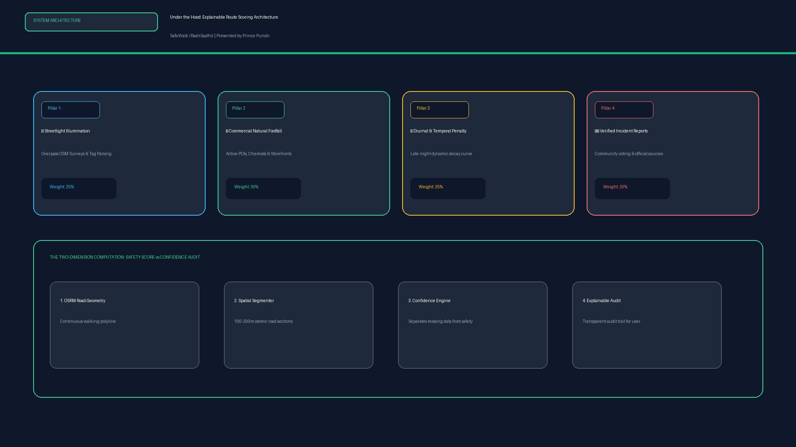
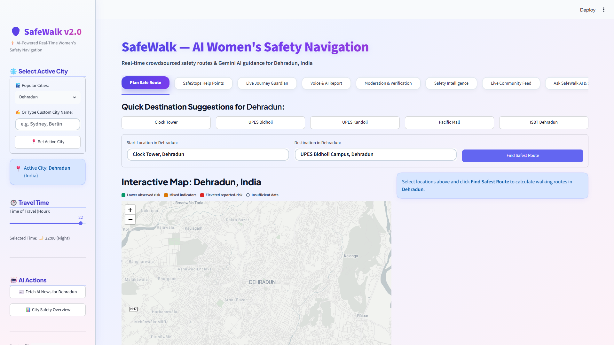
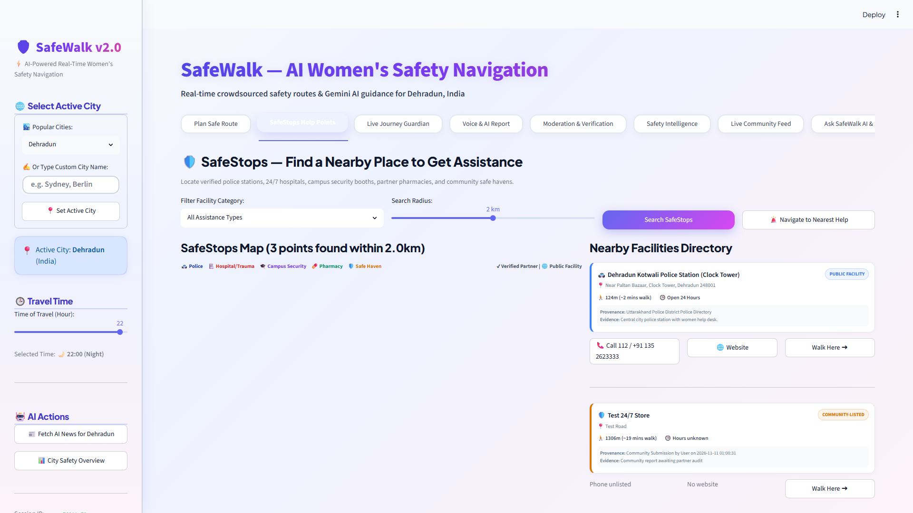
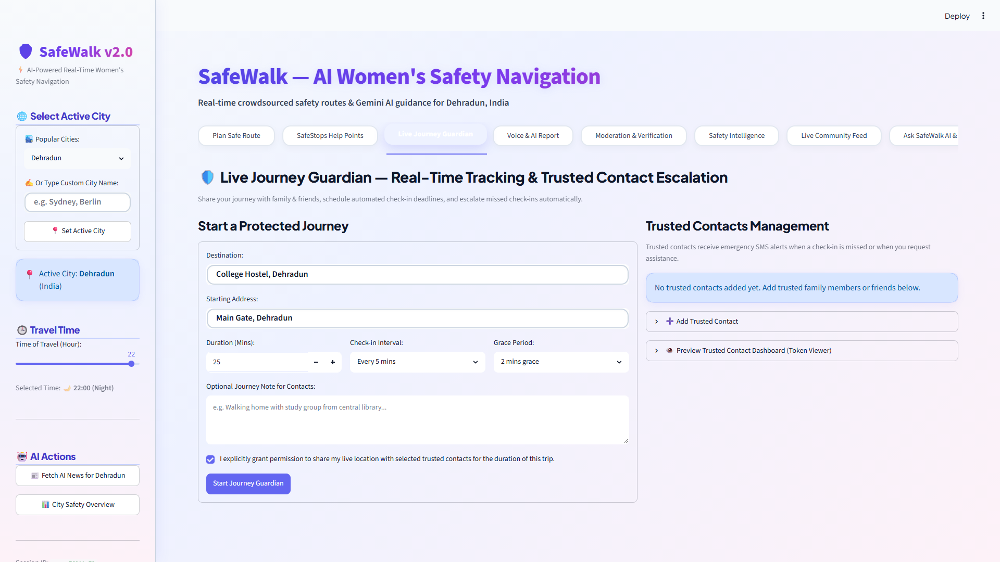
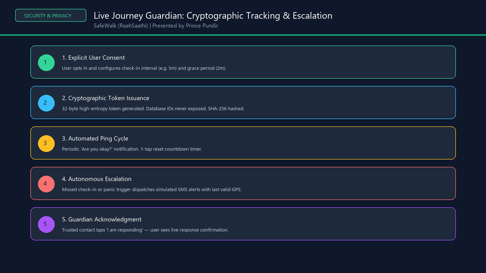
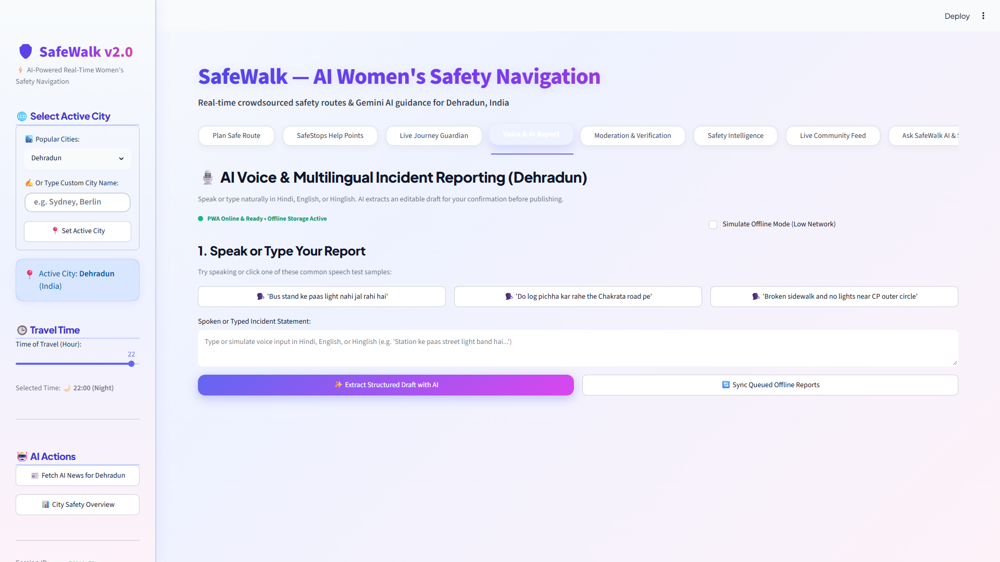
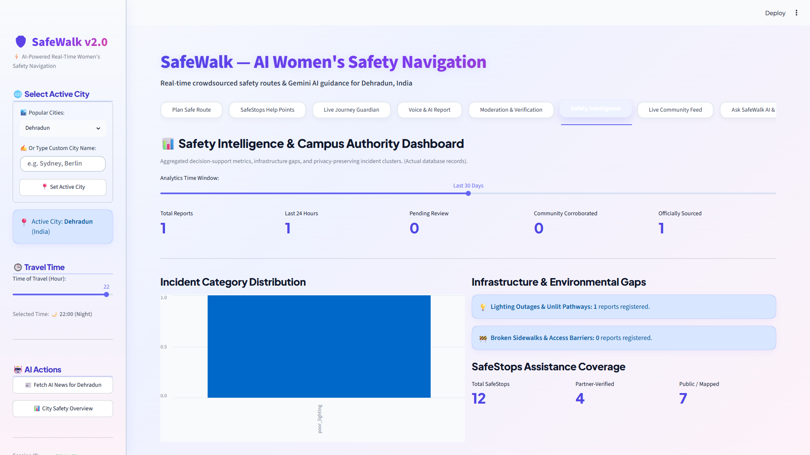

# 🛡️ SafeWalk (RaahSaathi)
> **"Google Maps shows the fastest route. SafeWalk shows the safest route — for any city worldwide, updated in real-time by women themselves."**

[](https://www.python.org/)
[](https://deepmind.google/technologies/gemini/)
[]()
[]()
[]()
[]()

---

## 📌 1. Project Overview & Problem Statement

Mainstream navigation applications (such as Google Maps and Apple Maps) optimize exclusively for **speed** ($\text{Distance} \div \text{Time}$). For a woman commuting alone late at night, shaving 90 seconds by cutting through an unlit back-alley, an abandoned underpass, or an unmonitored industrial stretch can be hazardous.

**SafeWalk (RaahSaathi)** re-engineers urban pedestrian navigation from the ground up by prioritizing **human safety and survival over raw transit time**.



### Key Value Propositions
* 🟢 **Dual-Route Safety Optimization:** Simultaneously calculates the standard shortest-path (*Fastest Route* in Coral Red) and the algorithmically optimized *Safest Route* (Emerald Green) avoiding unlit and high-risk zones.
* 🔍 **Explainable Segment-Level Intelligence:** Slices walking routes into 100m–200m atomic road segments, showing explicit evidence for lighting, commercial footfall, diurnal decay, and data confidence.
* 🚨 **SafeStops Assistance Havens:** One-tap emergency diversion routing to verified 24/7 safe physical spaces (Police, Trauma Centers, University Security Desks, Late-Night Chemists).
* 🛡️ **Live Journey Guardian:** Cryptographically signed live trip monitoring, automated periodic check-ins, and zero-auth simulated SMS alerts with live response acknowledgement.
* 🎙️ **Multilingual AI Voice Reporting:** Conversational incident reporting in Hindi, English, and Romanized Hinglish with AI structured entity extraction and review gating.
* 📶 **Progressive Web App (PWA) & Offline Sync:** Client-side IndexedDB caching and cryptographic idempotency keys allowing full navigation and offline hazard queueing in low-network transit zones.
* 📊 **Institutional Safety Intelligence Dashboard:** Real-time spatial clustering (1.1km generalized privacy cells) and municipal infrastructure gap tracking without tracking individual users.

---

## 🏗️ 2. Comprehensive System Architecture

SafeWalk is built as a modular, low-latency geospatial intelligence engine:



### The 4-Pillar Explainable Route Scoring Algorithm
Each road segment ($s$) is independently evaluated on a continuous scale ($0 - 100$):

$$\text{Safety Score}(s) = w_l \cdot S_{\text{light}} + w_c \cdot S_{\text{commercial}} - P_{\text{diurnal}}(t) - \sum \text{DecayedIncidents}(s) + B_{\text{police}}$$

Where:
1. **$S_{\text{light}}$ (Streetlight Illumination, 25% weight):** Grounded in surveyed OpenStreetMap `lit=yes/no` tags and lamp-post density.
2. **$S_{\text{commercial}}$ (Commercial Natural Footfall, 30% weight):** Number of active evening/night venues (chemists, 24/7 groceries, transit kiosks).
3. **$P_{\text{diurnal}}(t)$ (Temporal Day/Night Penalty, 25% weight):** Continuous sinusoidal penalty peaking at 02:00 AM.
4. **$\sum \text{DecayedIncidents}(s)$ (Dynamic Incident Weight, 20% weight):** Community and verified reports decayed via a 48-hour half-life exponential formula:
   $$\text{Weight}(t) = e^{-\frac{0.693 \cdot \Delta t}{48}} \times \text{TrustModifier} \times \text{CorroborationBonus}$$



---

## 📸 3. User Interface & Feature Walkthrough

### 1. Dual-Route Navigation & Explainable Segment Analysis
Calculates the safest route alongside the shortest route, highlighting streetlight coverage, commercial vibrancy, and hazard points.


---

### 2. Segment-Level Deep-Dive & 4-Pillar Confidence Audit
Users inspect individual 100m–200m road sections to understand the exact reasons behind the rating. Missing data is strictly distinguished from good conditions.


---

### 3. SafeStops: Instant Nearby Assistance Directory
Verified physical havens categorized into police stations, emergency trauma centers, campus security booths, and 24/7 pharmacies with 1-tap emergency rerouting.


---

### 4. Live Journey Guardian & Cryptographic Safety Tracking
Zero-knowledge live journey sharing using 32-byte cryptographic tokens (SHA-256 hashed). Periodic "Are you okay?" check-ins automatically escalate if missed.




---

### 5. Multilingual AI Voice Reporting & Offline PWA Sync
Speak naturally in Hindi, English, or Romanized Hinglish (*"Bus stand ke paas light nahi jal rahi hai"*). The AI extracts structured JSON drafts for user review. Works offline with client-side idempotency keys.


---

### 6. Institutional Safety Intelligence & Municipal Heatmaps
Authorized campus security and municipal planners inspect infrastructure gaps (e.g. recurring broken streetlight clusters) using privacy-preserving 1.1km spatial cells.


---

## 📂 4. Project Directory Structure

```text
SafeWalk/
│
├── ai_backend/                                 # AI & RAG Intelligence Layer
│   ├── genai_layer.py                         # Gemini AI: Safety briefings, NLP entity extraction, SOS SMS
│   ├── news_incident_fetcher.py                # Live crime advisory & news ingestion with Search Grounding
│   └── rag_knowledge.py                        # RAG Vector Store: WHO Guidelines & NCRB safety standards
│
├── backend/                                   # Core Geospatial & Business Logic
│   ├── safewalk_service.py                     # Master unified API controller
│   ├── route_segmenter.py                      # 100m-200m atomic road geometry segmentation
│   ├── segment_analyzer.py                     # Segment-level multi-factor evidence evaluator
│   ├── confidence_engine.py                    # 4-pillar data confidence & missing-data scoring
│   ├── safestops_service.py                    # SafeStops assistance directory & dynamic rerouting
│   ├── journey_guardian_service.py             # Cryptographic live tracking & escalation engine
│   ├── trusted_contacts_service.py             # Emergency contact notification dispatcher
│   ├── multilingual_voice_reporting.py         # Hinglish/Hindi NLP & voice incident processing
│   ├── community_verification_moderation.py    # Dual-dimension community corroboration & voting
│   ├── offline_sync_service.py                 # PWA offline queue & idempotent synchronization
│   ├── safety_intelligence_service.py          # Institutional geospatial risk clustering & analytics
│   ├── geocoder.py                             # High-precision multi-stage geocoder & landmark store
│   ├── osm_safety_data.py                      # OpenStreetMap Overpass spatial queries
│   ├── router.py                               # OSRM pedestrian routing integration
│   ├── safety_scorer.py                        # Multi-factor route safety scorer
│   ├── report_manager.py                       # Incident persistence & half-life exponential decay
│   └── setup_db.py                             # Database schema initialization & seeding
│
├── frontend/                                  # Web Application & UI Layer
│   ├── app.py                                  # Streamlit multi-tab production application
│   ├── map_builder.py                          # Folium geospatial builder with dual polylines
│   ├── manifest.json                           # PWA web app manifest
│   └── service-worker.js                       # PWA service worker for offline asset caching
│
├── docs/                                      # Documentation & Visual Assets
│   └── screenshots/                            # High-resolution production UI captures & architecture
│
├── tests/                                     # Automated Test Suites
│   ├── test_explainable_routing.py             # Unit tests for segmenting & explainability
│   ├── test_safestops_guardian.py              # Unit tests for SafeStops & Journey Guardian
│   ├── test_features_4_to_7.py                 # Unit tests for voice, offline sync & intelligence
│   └── test_integration.py                     # End-to-end integration test suite
│
├── safewalk.db                                # SQLite production database
├── requirements.txt                           # Python production dependencies
└── README.md                                  # Comprehensive documentation
```

---

## 🛠️ 5. Technology Stack

| Layer | Technologies |
| :--- | :--- |
| **Frontend UI** | Streamlit, Folium, Streamlit-Folium, HTML5 Canvas, PWA Service Worker |
| **Backend & Routing** | Python 3.10+, OSRM Pedestrian Routing Engine, OpenStreetMap Overpass API |
| **Artificial Intelligence** | Google Gemini AI (NLP Entity Extraction & Multimodal Voice Interpretation) |
| **Geospatial Processing** | Shapely, Geopy, Haversine Coordinate Formulas, Folium PolyLines |
| **Security & Privacy** | SHA-256 Token Hashing, 32-Byte High-Entropy Secrets, 1.1km Generalized Spatial Cells |
| **Database** | SQLite3 (WAL-Mode, Zero-Dependency Embedded Relational Engine) |

---

## 🚀 6. Getting Started & Local Installation

### Prerequisites
* Python 3.10 or higher
* Git

### Installation Steps

1. **Clone the repository:**
   ```bash
   git clone https://github.com/PrincePundir123/RAAHSAATHI.git
   cd RAAHSAATHI
   ```

2. **Create and activate a virtual environment:**
   ```bash
   python -m venv venv
   # On Windows:
   venv\Scripts\activate
   # On macOS/Linux:
   source venv/bin/activate
   ```

3. **Install dependencies:**
   ```bash
   pip install -r requirements.txt
   ```

4. **Configure Environment Variables:**
   Create a `.env` file in the root directory:
   ```ini
   GEMINI_API_KEY="your-gemini-api-key"
   DEBUG=False
   ```

5. **Initialize the Database:**
   ```bash
   python backend/setup_db.py
   ```

6. **Run the Application:**
   ```bash
   python -m streamlit run frontend/app.py
   ```
   Open your browser and navigate to `http://localhost:8501`.

---

## 🧪 7. Automated Test Suite

SafeWalk includes comprehensive unit and integration test coverage across all features:

```bash
# Run all unit and integration tests
python -m unittest discover tests/
```

Test coverage includes:
* **Route Segmenter:** Validation of continuous road polyline subdivision (100m–200m lengths).
* **Confidence Engine:** Verification that zero reports results in low confidence, not falsely high safety.
* **Journey Guardian:** Verification of 32-byte cryptographic token hashing and escalation trigger thresholds.
* **Offline Sync:** Validation of client-generated idempotency keys to ensure zero duplicate database insertions.

---

## 🔒 8. Security, Ethics & Privacy Principles

1. **Zero Location History Profiling:** Users do not need an account to navigate. Journey Guardian links expire automatically after trip completion.
2. **Cryptographic Token Protection:** Journey Guardian URLs share an opaque 32-byte token. Database integer IDs are never exposed in URLs or network payloads.
3. **Data Provenance Integrity:** Open datasets (`PUBLIC FACILITY`) are strictly separated from verified institutional partners (`PARTNER-VERIFIED`). SafeWalk never infers official endorsement from community upvotes.
4. **Aggregated Municipal Privacy:** Institutional intelligence heatmaps enforce minimum incident thresholds and 1.1km generalized spatial grid cells, preventing de-anonymization of individual travel habits.

---

## 📄 License
This project is licensed under the MIT License — see the LICENSE file for details.
